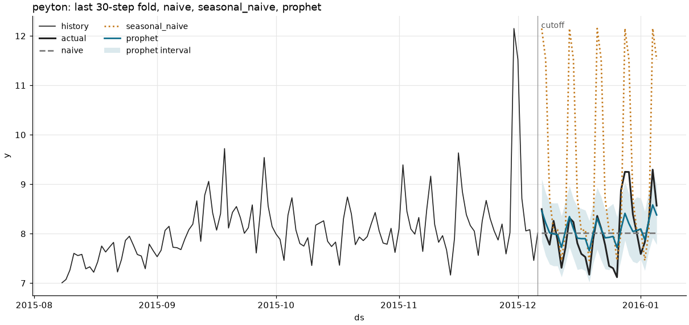
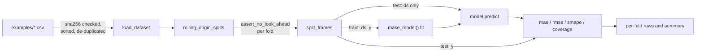
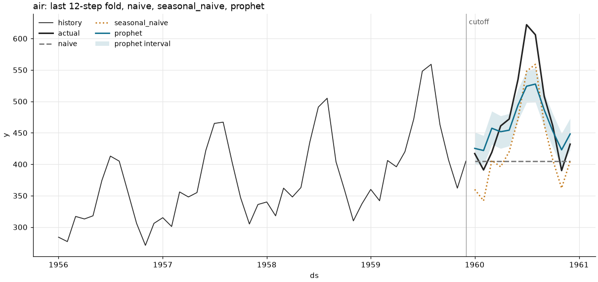

# prophet_playaround

A backtesting playground for [Prophet](https://github.com/facebook/prophet), Meta's
time-series forecasting library. It answers one question honestly: **on a given series,
does Prophet beat a trivial baseline on folds it could not have peeked at?**

The first-party code is `playground/`, a small harness that runs Prophet and two naive
baselines through the *same* rolling-origin folds, checks the look-ahead invariant on every
fold, seeds Prophet so its intervals reproduce, and prints or plots the result. Everything
else of substance in the repository is upstream Prophet, kept for reference.



## What is upstream and what is this project's

| Path | Origin | How it is used here |
| --- | --- | --- |
| `playground/` | **This project** | The harness, CLI and its tests. |
| `Dockerfile`, `docker-compose.yml`, `docker-healthcheck.py`, `Makefile`, `pyproject.toml`, `requirements*.txt`, `.python-version` | **This project** | Build, run and tooling. |
| `docs/captured/`, `docs/screenshots/` | **This project** | Transcripts and plots quoted in this README. |
| `python/` | facebook/prophet 1.1.4 (MIT) | Reference copy of the Python package, Stan model and upstream tests. **Not installed or imported.** |
| `python_shim/` | facebook/prophet (MIT) | Upstream's `fbprophet` compatibility shim. Reference only. |
| `examples/` | facebook/prophet | The example CSVs. The harness reads five of them. |
| `notebooks/` | facebook/prophet | Upstream's documentation notebooks. Outputs were stripped from ten of them to drop about 13 MB of embedded images. The cell sources are unchanged. |
| `docs/` (everything else) | facebook/prophet | Upstream's Jekyll site, served as-is. It documents the library, including the R API, not this project. Only `Gemfile.lock` was re-resolved here (see below). |
| `LICENSE`, `CODE_OF_CONDUCT.md` | facebook/prophet | Unaltered. |

`python/prophet/` and `python/stan/prophet.stan` were checked file by file against the
PyPI sdist of prophet 1.1.4 and match it exactly. The only differences under `python/` are
`setup.py` and `pyproject.toml`, which carry two upstream commits from just after that
release. The sdist's `hdays.py` is generated at build time and is absent here. The vendored
tree is excluded from linting and formatting, so it can still be diffed against upstream.

## How a backtest runs



- **A fresh model per fold.** `backtest()` takes a factory, not an instance, so no state
  leaks across cutoffs. Folds are independent, and `map_fn` accepts e.g.
  `ProcessPoolExecutor().map` to run them in parallel.
- **Leakage is prevented by construction, then checked.** `fit` receives training rows;
  `predict` receives timestamps only, so there is no parameter through which a future `y`
  can reach a model. `assert_no_look_ahead` runs when folds are generated and again when
  they are materialised.
- **Pinned data.** Every dataset carries a SHA-256 digest that is verified on load, so a
  quoted number cannot drift because a CSV changed.
- **Seeded Prophet.** Prophet draws its uncertainty samples from NumPy's global RNG and
  seeds it nowhere. `ProphetForecaster` seeds it before `fit` and `predict`.

## Running it

### With Docker (no local Python needed)

```bash
docker compose build playground
docker compose run --rm playground            # Peyton backtest, per fold and summary
docker compose run --rm playground python -m playground datasets
make docker-test                              # fast suite, slow suite, ruff
```

The image is `python:3.12-slim` plus pinned wheels. It runs as a non-root user with a
read-only filesystem and no network. To keep a plot, mount a folder:

```bash
docker compose run --rm -v "$PWD/out:/out" playground \
  python -m playground plot --dataset peyton --out /out/peyton.png
```

On Linux the container user (uid 10001) needs write access to `out/`. Docker Desktop on
macOS handles that for you.

### With a local virtualenv

```bash
python3.12 -m venv .venv && . .venv/bin/activate
pip install -r requirements-dev.txt
python -m playground backtest --dataset peyton --per-fold
python -m pytest playground -q            # 67 fast tests, no Prophet fits
python -m pytest playground -q -m slow    # 4 tests that really fit Prophet
```

`make help` lists the same steps as targets.

### Commands

| Command | What it does |
| --- | --- |
| `python -m playground datasets` | Lists the five pinned series and verifies every checksum. |
| `python -m playground backtest [--dataset D] [--models ...] [--horizon N] [--initial N] [--period N] [--max-folds N] [--per-fold]` | Scores each model on identical walk-forward folds. |
| `python -m playground determinism` | Fits Prophet twice unseeded and twice seeded, and reports how far the output moves. |
| `python -m playground plot --out FILE.png [--dataset D] [--models ...]` | Draws the most recent fold: history, actuals, each model's forecast, and Prophet's interval. |

Datasets: `peyton` (daily log page views), `retail` (monthly sales), `air` (monthly
airline passengers), `pedestrians` (daily counts across the 2020 COVID shock) and
`yosemite` (5-minute temperatures). The models are `naive` (last value carried forward),
`seasonal_naive` (repeat the last seasonal cycle) and `prophet` (library defaults, seeded).

## Results on the Peyton Manning series

Five 30-day folds, an expanding window starting at 730 observations, captured in the Docker
image with no network ([full transcript](docs/captured/backtest-peyton.txt)):

```
$ python -m playground backtest --dataset peyton --horizon 30 --initial 730 --max-folds 5
model            folds      mae     rmse    smape   cover  total_s
-----------------------------------------------------------------
naive                5   0.4633   0.6276   0.0281       -     0.00
seasonal_naive       5   0.6250   0.8753   0.0357       -     0.00
prophet              5   0.3153   0.4896   0.0188   0.893     2.04 *

* lowest mean MAE across identical folds: prophet
```

- Prophet's mean MAE is 32% lower than carrying the last value forward (0.3153 against
  0.4633).
- Seasonal-naive comes last. The plot above shows why: its final fold replays the
  spike from the week before the cutoff every week, and that one fold scores an MAE of 1.39.
- Nominal 80% intervals covered 89.3% of actuals. They are wider than they need to be,
  which is a calibration cost, not a win.

Units are log page views, so `smape` is the column to compare across series. This is five
folds of one series at library defaults, with no tuning. It is a reproducible measurement,
not a benchmark. On the vendored 1.1.4 the same run gave 0.3149. The 0.0004 shift comes from
the newer Prophet and CmdStan in the 1.5.0 wheel.

For contrast, on monthly airline passengers the seasonal baseline wins easily, and a test
pins that (`test_backtest_prints_one_summary_row_per_model`):



## Two findings worth knowing

**Prophet's point forecast is reproducible; its intervals are not.**
[`docs/captured/determinism.txt`](docs/captured/determinism.txt): two unseeded fits give
identical `yhat` (`max |delta| = 0`), while the interval bounds move by up to 0.11 against a
mean interval width of 1.24. Seeding `np.random` before each fit removes that variation
entirely. Prophet 1.5.0 still has no seed parameter, which is why the adapter seeds the
global RNG.

**One vendored upstream test cannot pass.** `python/prophet/tests/test_prophet.py:61`
asserts `236 < res < 193`, which no number satisfies. It is marked `slow`, and upstream's
`conftest.py` skips slow tests unless `--test-slow` is passed, so it never runs by default.
It is left as upstream wrote it.

## Verification

Captured in [`docs/captured/tests.txt`](docs/captured/tests.txt):

| Check | Result |
| --- | --- |
| `pytest playground -q` | 67 passed, 4 deselected |
| `pytest playground -q -m slow` | 4 passed (real Prophet 1.5.0 fits) |
| `ruff check` / `ruff format --check` | clean, 21 files |
| `python docker-healthcheck.py` | exit 0 |

The leakage tests are known to fail when leakage is introduced.
[`docs/captured/leakage-injection.txt`](docs/captured/leakage-injection.txt) records a run
with the guard disabled and the training windows stretched over the test window: 5 failed,
including 3 in `test_leakage.py`. [`playground/tests/README.md`](playground/tests/README.md)
explains what each test file pins.

## Design choices

- **Prophet from the PyPI wheel, not the vendored source.** The 1.1.4 snapshot needs
  NumPy < 2 and, on a fresh machine, a CmdStan download and compile that takes tens of
  minutes. The 1.5.0 wheel ships a compiled Stan model for x86-64 and arm64 Linux and
  macOS, so installing takes seconds and the image needs no compiler. The vendored tree
  stays as a readable, diffable reference.
- **Exact pins.** `requirements.txt` pins Prophet, CmdStanPy, NumPy, pandas and Matplotlib
  exactly, because the README quotes numbers to four decimals.
- **Baselines ship with the real model.** A Prophet score is only meaningful next to a
  baseline on the same folds. Adding a model is one class plus one `@register_forecaster`
  line.

## Docs site

`docker compose --profile docs up docs` serves upstream's Jekyll site at
<http://localhost:8850/prophet/>. The first start installs gems into a named volume, which
takes a few minutes. The 2021 `docs/Gemfile.lock` (github-pages 209) had 55 known
advisories, including critical ones in kramdown and commonmarker. It was re-resolved to
github-pages 233, and `bundle-audit` now reports none.

## Limitations

- The vendored `python/` package and its upstream test suite are not executed here. Running
  them needs NumPy < 2 and a local CmdStan build.
- Plotly is not installed, so Prophet prints "Importing plotly failed" when it is imported.
  Its interactive plots are unused. The harness plots with Matplotlib.
- One series sits behind the headline numbers. There is no hyperparameter search and no
  interval recalibration.

## License and attribution

Prophet is MIT-licensed, copyright Facebook, Inc. and its affiliates. See [LICENSE](LICENSE),
which is upstream's file, unaltered, as are the per-file copyright headers under `python/`
and `python_shim/`. Upstream's documentation site in `docs/` carries its own
[CC BY 4.0 license](docs/LICENSE). This project's own code (`playground/` and the tooling
listed above) is offered under the same MIT terms. For the library itself, the authoritative
references are [facebook/prophet](https://github.com/facebook/prophet) and its documentation.
