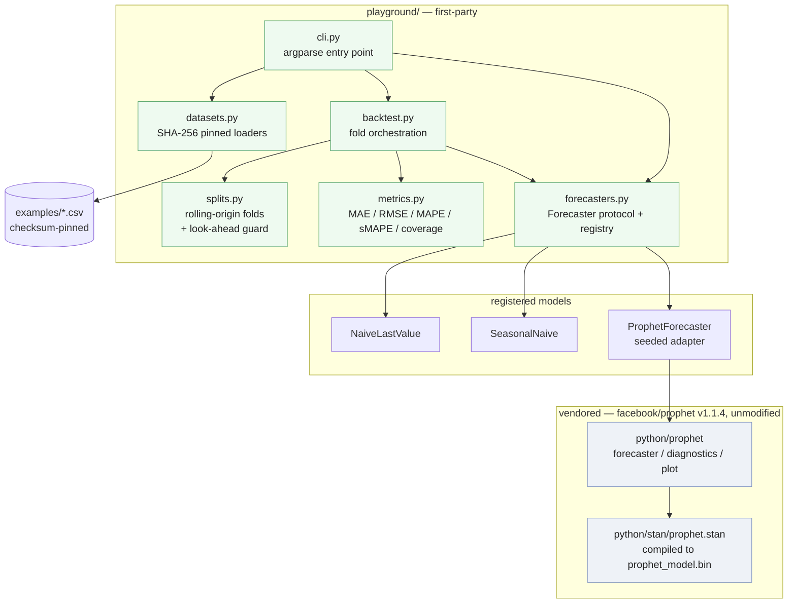
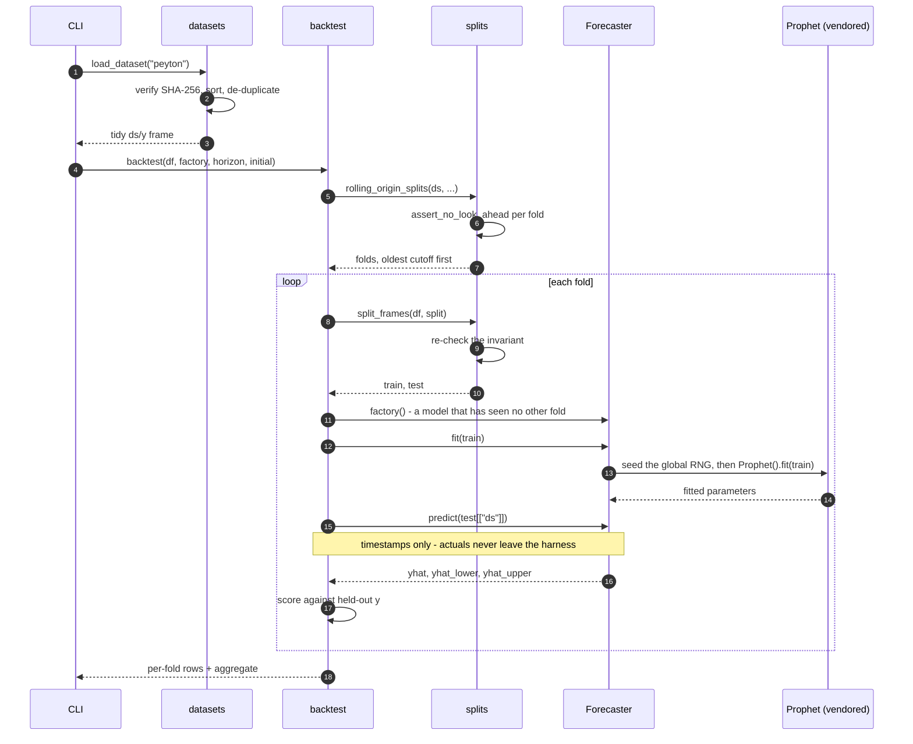

# prophet_playaround

A **fork of [facebook/prophet](https://github.com/facebook/prophet) v1.1.4** with the R
package removed, plus a small first-party layer — `playground/` — that turns the vendored
library into something you can actually make claims from: pinned datasets, rolling-origin
backtests with the look-ahead invariant enforced per fold, a seeded Prophet wrapper, and
baselines to compare against.

Being precise about what is whose, because the repository name hides it: **262 of the 281
tracked files are byte-identical to upstream v1.1.4.** Everything under `python/` and
`python_shim/` is Meta's code, unmodified. `playground/`, the Docker and CI setup, and this
README are the first-party parts.

> **Provenance, verified rather than asserted.** Reproduce the comparison yourself:
>
> ```bash
> curl -sL https://github.com/facebook/prophet/archive/refs/tags/v1.1.4.tar.gz | tar xz
> diff -rq python/prophet prophet-1.1.4/python/prophet   # no output: identical
> ```

## Captured output

No UI: this is a library fork plus a CLI. The transcripts below are the real, unedited
output of the commands shown, and live in [`docs/captured/`](docs/captured/).

### Prophet against baselines, on identical folds

Every model sees exactly the same five walk-forward folds of the Peyton Manning series
([`docs/captured/backtest-peyton.txt`](docs/captured/backtest-peyton.txt)):

```
$ python -m playground backtest --dataset peyton --horizon 30 --initial 730 --max-folds 5 --per-fold
dataset   : peyton (example_wp_log_peyton_manning.csv)
rows      : 2905  span 2007-12-10 .. 2016-01-20
sha256    : 6b1383a6f458e317c5da0488abaf2cadccd7e80c84c7a543d084e1159d5bfa56
horizon   : 30   initial: 730   period: 30   max_folds: 5

prophet / peyton / horizon=30
fold  cutoff       n_train      mae     rmse    smape   cover    secs
   0  2015-08-07      2740   0.2067   0.2591   0.0136   1.000    0.85
   1  2015-09-06      2770   0.2878   0.4340   0.0170   0.900    0.30
   2  2015-10-06      2800   0.2277   0.3077   0.0141   0.967    0.35
   3  2015-11-06      2830   0.5255   1.0164   0.0292   0.800    0.35
   4  2015-12-06      2860   0.3268   0.4272   0.0202   0.800    0.30

model            folds      mae     rmse    smape   cover  total_s
-----------------------------------------------------------------
naive                5   0.4633   0.6276   0.0281       -     0.00
seasonal_naive       5   0.6250   0.8753   0.0357       -     0.00
prophet              5   0.3149   0.4889   0.0188   0.893     2.15 *

* lowest mean MAE across identical folds: prophet
```

Three things that are worth more than the headline:

- Prophet earns its complexity here: **MAE 0.3149 against 0.4633 for last-value-carried-forward**,
  a 32% reduction, on folds neither model could have peeked at.
- **Seasonal-naive is the *worst* of the three** (0.6250). Weekly seasonality alone is not
  what makes this series predictable; the fitted trend is.
- Nominal-80% intervals covered **89.3%** of actuals. They are conservative — wide enough
  to be right more often than advertised, which is a calibration cost, not a win.

Units are log page-views, so these are not percentages; `smape` is the comparable figure.

### Determinism

[`docs/captured/determinism.txt`](docs/captured/determinism.txt):

```
$ python -m playground determinism --dataset peyton --horizon 30
two independent UNSEEDED fits
  max |delta yhat|        = 0.000e+00
  max |delta yhat_lower|  = 0.0965
  max |delta yhat_upper|  = 0.0950
  mean interval width     = 1.2505

two fits with np.random.seed(1234) before each
  max |delta yhat|        = 0.000e+00
  max |delta yhat_lower|  = 0.0000
  max |delta yhat_upper|  = 0.0000
```

Prophet's point forecast is a MAP estimate and repeats exactly. Its **interval bounds do
not**: Prophet samples them from the *global* NumPy RNG and seeds it nowhere, so the bounds
move by up to 0.0965 between runs against a mean interval width of 1.2505 — about 8% of the
interval. `playground.ProphetForecaster` seeds the global RNG before each fit and predict,
which removes the variation entirely.

### Proving the leakage tests can fail

A guard nobody has watched fail is decoration. [`docs/captured/leakage-injection.txt`](docs/captured/leakage-injection.txt)
records a run with two leaks deliberately injected into `playground/splits.py` — the guard
stubbed out, and training windows extended over the test window:

```
$ pytest playground -q --tb=line
...............................FF..F.............F........F              [100%]
FAILED playground/tests/test_leakage.py::test_overlapping_train_and_test_is_rejected
FAILED playground/tests/test_leakage.py::test_training_past_the_cutoff_is_rejected
FAILED playground/tests/test_leakage.py::test_model_is_never_shown_a_row_at_or_after_its_cutoff
FAILED playground/tests/test_splits.py::test_fold_count_and_shapes
FAILED playground/tests/test_splits.py::test_split_frames_are_contiguous_and_reindexed
5 failed, 54 passed, 4 deselected in 0.59s
```

Both leaks were reverted immediately afterwards; the suite is green on the committed tree.

## Architecture



Dependencies point one way only: `playground` imports Prophet, Prophet never imports
`playground`. The vendored tree is treated as a read-only third-party dependency that
happens to live in this repository — it is excluded from linting and formatting, because
reformatting it would destroy the ability to diff it against upstream, which is the single
most useful property this repository has.

## Backtest workflow

The ordering below is the whole point. A fresh model is built per fold, it is fitted only
on rows before the cutoff, and only *timestamps* cross into `predict` — actuals stay in the
harness.



## Quickstart

```bash
python -m venv .venv && source .venv/bin/activate
pip install -r requirements-dev.txt

# Fast path: baselines only, nothing to compile, runs in about a second.
PYTHONPATH=. python -m playground backtest --dataset peyton --models naive seasonal_naive

# Full path: builds CmdStan and compiles python/stan/prophet.stan. Slow the
# first time (tens of minutes), cached afterwards.
pip install -e python/
PYTHONPATH=. python -m playground backtest --dataset peyton --per-fold
```

`make help` lists the same steps as targets.

## Configuration

`playground` has no required configuration; every knob is a command-line flag. The two
environment variables that matter:

| Name | Required | Default | Purpose |
| --- | --- | --- | --- |
| `PYTHONPATH` | only off-root | unset | Needed when invoking from outside the repository root; running `python -m playground` *from* the root already puts it on `sys.path`. The Docker image sets it to `/app`. |
| `PLAYGROUND_SKIP_CHECKSUM` | no | unset | Set to `1` to load a dataset whose SHA-256 no longer matches. For local experiments only; tests never set it, and any metric produced with it set is unpinned. |
| `PROPHET_REPACKAGE_CMDSTAN` | no | `True` | Read by the **vendored** `python/setup.py`. Set to `False` to build against an existing CmdStan instead of downloading one. |
| `STAN_BACKEND` | no | `CMDSTANPY` | Read by the **vendored** Prophet. The only backend v1.1.4 ships. |

CLI flags for `backtest`: `--dataset`, `--models`, `--horizon`, `--initial`, `--period`,
`--max-folds`, `--seed`, `--per-fold`. Run `python -m playground backtest --help`.

## Development

```bash
make test         # fast suite: 59 tests, no Stan binary needed, under a second
make test-slow    # 4 tests that really fit Prophet
make test-vendored# upstream's own suite: 68 tests
make lint         # ruff, first-party code only
make datasets     # verify every pinned dataset's checksum
```

The fast suite deliberately fits nothing. Fixtures are synthetic series of a few hundred
seeded points, so a broken invariant is reported in under a second and CI needs no compiler.
Tests that need the compiled Stan model are marked `slow` and deselected by default; the
marker name matches the one upstream's `conftest.py` already uses.

## Project structure

```
playground/                first-party code — the only original code here
  datasets.py              SHA-256-pinned loaders for examples/*.csv
  splits.py                rolling-origin folds; the look-ahead guard lives here
  backtest.py              one fresh model per fold, scored against held-out rows
  metrics.py               MAE / RMSE / MAPE / sMAPE / interval coverage
  forecasters.py           Forecaster protocol, registry, baselines, seeded Prophet adapter
  cli.py                   python -m playground {datasets,backtest,determinism}
  tests/                   63 tests; see playground/tests/README.md
docs/captured/             real terminal transcripts quoted by this README
python/                    VENDORED facebook/prophet v1.1.4 — do not edit
python_shim/               VENDORED fbprophet compatibility shim
examples/                  VENDORED example CSVs, pinned by checksum
notebooks/, docs/          VENDORED upstream notebooks and Jekyll documentation site
```

## Design notes

**Why a fork needs a first-party layer at all.** Before this pass the repository contained
no original code: `Dockerfile`, `docker-compose.yml`, `Makefile`, `CODE_OF_CONDUCT.md` and
`docs/README.md` were all byte-identical to upstream, and the only edit anywhere was the
deletion of the R installation section from this README. A fork that adds nothing is just a
stale copy. `playground/` is the smallest thing that makes the fork worth having: it is the
harness upstream does not ship, and it is where a reviewer can see judgement being applied.

**Leakage is prevented structurally, then checked.** The `Forecaster` protocol takes a
training frame in `fit` and *timestamps only* in `predict`. There is no parameter through
which a future `y` could reach a model, which is stronger than checking for leakage after
the fact. On top of that, `assert_no_look_ahead` runs both when folds are generated and
again when they are materialised, and `test_leakage.py` pins the invariant from four
directions: overlapping index sets, a training window past its cutoff, unsorted or
duplicated timestamps, and — behaviourally — recording the widest window a model was ever
shown and asserting it ends before the test window starts.

The specific leak worth naming is the fitted scaler. Prophet's `initialize_scales` derives
`y_scale`, `start` and `t_scale` from whatever frame it is handed, so fitting once on the
full series and slicing predictions afterwards silently normalises against data from the
future. `test_scaling_constants_come_from_training_data_only` puts a 500.0 spike inside the
first test window and asserts `m.y_scale` matches the *training* maximum.

**Determinism was measured, not assumed.** See the captured output above. The wrapper seeds
`np.random` rather than passing a seed through, because Prophet v1.1.4 exposes no seed
parameter — `sample_model` and `sample_predictive_trend` call `np.random.normal`,
`np.random.laplace` and friends directly.

**The extension seam is the baseline comparison.** A Prophet score in isolation is not
evidence. The registry exists so the same folds can be replayed through any model that
implements two methods; adding one is a class and a `@register_forecaster` line, with no
change to `backtest.py`. The two baselines shipped are not filler — seasonal-naive coming
last is a result, and one you cannot get without running it.

**Scalability: the bottleneck is fitting, and it is not worth parallelising by default.**
Measured on the captured run, the five Prophet folds cost 2.15 s in total against 0.00 s for
both baselines — fold-fitting is essentially all of the wall clock, and it grows linearly in
folds and roughly linearly in training rows (0.046 s at 150 rows, 2.1 s at 2905). Folds are
independent, so `backtest(..., map_fn=...)` accepts any `map`-shaped callable and a caller
with spare cores can pass `ProcessPoolExecutor(...).map`. It is *not* the default, because
each Stan fit already uses multiple threads and over-subscribing cores makes a backtest
slower; the honest default is sequential, with the seam available. The second real cost is
`--max-folds`, which bounds a backtest to the most recent cutoffs rather than every cutoff
in eight years of daily data.

**Dependency pinning is a correctness fix, not hygiene.** The vendored
`python/pyproject.toml` declares `numpy>=1.15.4` with no upper bound. A fresh install today
resolves NumPy 2.x and `import prophet` dies immediately on `np.float_`, removed in NumPy
2.0. Editing the vendored file would break the diff-against-upstream property, so the pins
live in `requirements-dev.txt` and in the Dockerfile instead, with the reason written down
next to them.

**A vendored test that can never pass.** The upstream suite has two tests behind
`@pytest.mark.slow`, which `conftest.py` skips unless `--test-slow` is passed. Running them
shows why nobody noticed: `test_fit_predict_sampling` asserts

```python
# python/prophet/tests/test_prophet.py:61  (byte-identical to upstream v1.1.4)
# this gives ~ 215.77
res = rmse(future["yhat"], test["y"])
assert 236 < res < 193, "backend: {}".format(forecaster.stan_backend)
```

`236 < res < 193` is unsatisfiable for every real number, so the assertion fails whatever
the model does. The measured value is also nowhere near the comment: **45.74**, against a
comment claiming ~215.77 and bounds implying ~200. The sibling test two methods up has the
same smell — a comment reading `# this gives ~ 10.64` above `assert res == pytest.approx(23.44, 0.01)`.

This fork does not patch it. Editing `python/` would forfeit the diff-against-upstream
property that makes the provenance claim at the top of this README checkable, and the fix
belongs upstream. It is recorded here so the number is not mistaken for a verified one.
The default vendored run — `pytest python/prophet/tests python_shim` — is **68 passed**,
with those two deselected exactly as upstream intends.

**What was deleted and why.** `public/fonts/` held sixteen files — FontAwesome web fonts and
a README describing a "Blockchain Explorer application" — committed by a `git add` that
reached into an unrelated project. Nothing in the tree referenced them
(`git grep -l 'fa-solid\|fontawesome\|BlockchainFont'` matched only the font files' own
internal metadata), so they are gone, along with 2.8 MB.

## Limitations

- **Docker is authored but unbuilt.** `Dockerfile` and `docker-compose.yml` were written to
  a multi-stage, non-root, healthchecked standard and parse-checked with `docker compose
  config`. They have **not** been built or booted — the daemon was switched off in the
  environment this pass ran in. Treat them as reviewed source, not as verified artefacts.
- **The numbers above are five folds of one series.** They are reproducible and
  leakage-checked, not a benchmark. Nothing here establishes how Prophet behaves on your
  data, and the `--max-folds 5` default exists for wall-clock reasons, not statistical ones.
- **Intervals are conservative at 89.3% empirical coverage for a nominal 80%.** The harness
  measures coverage; it does not recalibrate.
- **No hyperparameter search.** Prophet runs at library defaults. A tuned Prophet would
  very likely beat these numbers, and a tuned baseline might close some of the gap.
- **The vendored library is frozen at v1.1.4 and is not maintained here.** Upstream has
  released newer versions with macOS arm64 wheels and NumPy 2 support. Do not file library
  bugs against this fork.
- **The Jekyll site under `docs/` is upstream's, unmodified,** and documents
  `facebook/prophet` including its R API, which this fork removed. It is kept for provenance,
  not as documentation of this repository.
- **One vendored test is broken and stays broken** (see Design notes). It is opt-in behind
  `--test-slow`, so the default suites are green, but `pytest python/prophet/tests -m slow
  --test-slow` will report one failure.
- **Only Python 3.10 was executed.** The CI matrix lists 3.10 and 3.11; 3.11 is untested here.
- **The CI workflow has not run.** It was written against the pinned requirements but this
  repository has no CI history to point at.

## License

The vendored Prophet code is MIT, copyright Meta Platforms, Inc. — see [LICENSE](LICENSE).
The first-party `playground/` code is offered under the same terms.
